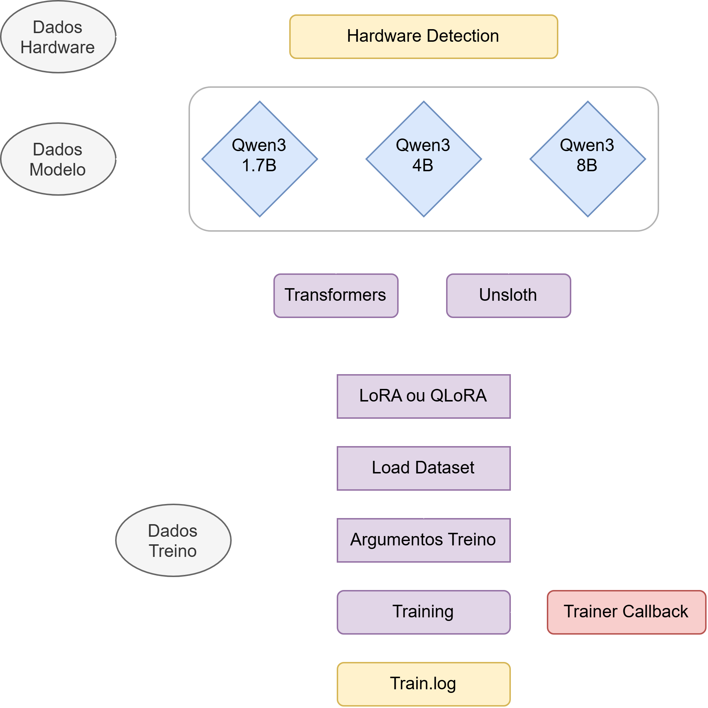

<a href = "https://github.com/Eliezer-Carvalho/MAIA/blob/master/3.%20fugazi_training/training.py"> <h1> training.py </h1> </a>
<p align = "center">    </p>
<hr>

Esta função tem como objetivo realizar o <b> <i> Parament Efficient Fine-Tuning </b> </i> baseado nos datasets provenientes da Sequence Length Distribution. <br>
Um dos objetivos é ser portável para qualquer GPU NVIDIA, possibilitando assim vários testes em várias configurações de Hardware. <br>

Libraries

```json
"Hardware": {
  "import torch",
  "import psutil",
}

"Model": {
  "from transformers import AutoTokenizer, AutoModelForCausalLM, BitsAndBytesConfig",
  "from unsloth import FastLanguageModel",
}

"PEFT": {
  "from peft import LoraConfig, get_peft_model, prepare_model_for_kbit_training",
}

"Datasets e Logs": {
  "from datasets import load_dataset",
  "import logging",
  "import yaml"
}

"Training": {
  "from transformers import TrainingArguments, Trainer"
}

"Training Stats": {
  "from transformers import TrainerCallback",
  "import time",
  "import numpy as np",
  "from pynvml import nvmlInit, nvmlDeviceGetHandleByIndex, nvmlDeviceGetMemoryInfo, nvmlDeviceGetUtilizationRates"
}
```
Code Explanation

```python
class Treino_Log (TrainerCallback)
```
É o <i>TrainerCallback</i> que permite retirar as seguintes estatísticas durante o treino.


| Nome Variáveis | Descrição | Unidade |
|:----------------------------:|-----|:----:|
| CPU_MEM | Memória da CPU | GB |
| CPU_UTIL | Utilização da CPU | % | 
| GPU_MEM | Memória da GPU | GB | 
| TORCH_MEM_GPU_ALLOC | Memória da GPU Alocada pelo PyTorch | GB |
| amalia-llm/smol_summarize_pt | :x: | :x: | :x: | :x: |
| amalia-llm/persona_instruction_following | :x: | :white_check_mark: | :white_check_mark: | :white_check_mark: |
| amalia-llm/ptpt-linguistics-if | :x: | :x: | :white_check_mark: | :x: |
| amalia-llm/persona_general | :x: | :white_check_mark: | :white_check_mark: | :white_check_mark: | :white_check_mark: |
| amalia-llm/smoltalk2_everyday_conv_pt | :x: | :white_check_mark: | :white_check_mark: | :x: |
| amalia-llm/wikipedia_conversations | :white_check_mark: | :x: | :white_check_mark: | :x: |
| amalia-llm/wmt24pp_xx_to_pt_10k | :x: | :x: | :white_check_mark: | :x: |
