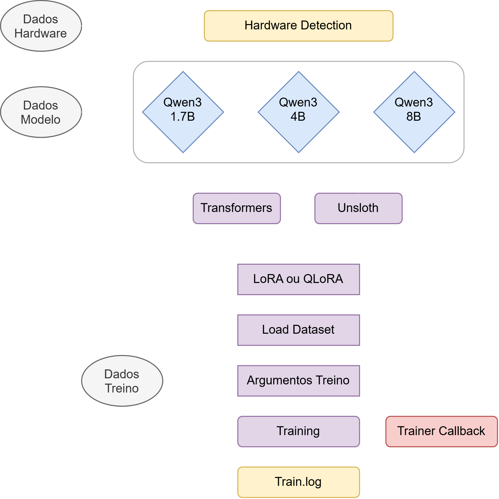

<a href = "https://github.com/Eliezer-Carvalho/MAIA/blob/master/3.%20fugazi_training/training.py"> <h1> training.py </h1> </a>
<p align = "center">    </p>
<hr>

Esta função tem como objetivo realizar o <b> <i> Parament Efficient Fine-Tuning </b> </i> baseado nos datasets provenientes da Sequence Length Distribution. <br>
Um dos objetivos é ser portável para qualquer GPU NVIDIA, possibilitando assim vários testes em várias configurações de Hardware. <br>

<h3> Libraries </h3>
<hr>

```json
"Hardware": {
  "import torch",
  "import psutil",
}

"Model": {
  "from transformers import AutoTokenizer, AutoModelForCausalLM, BitsAndBytesConfig",
  "from unsloth import FastLanguageModel",
}

"PEFT": {
  "from peft import LoraConfig, get_peft_model, prepare_model_for_kbit_training",
}

"Datasets e Logs": {
  "from datasets import load_dataset",
  "import logging",
  "import yaml"
}

"Training": {
  "from transformers import TrainingArguments, Trainer"
}

"Training Stats": {
  "from transformers import TrainerCallback",
  "import time",
  "import numpy as np",
  "from pynvml import nvmlInit, nvmlDeviceGetHandleByIndex, nvmlDeviceGetMemoryInfo, nvmlDeviceGetUtilizationRates"
}
```
<h3> Code Explanation </h3>
<hr>

```python
class Treino_Log (TrainerCallback)
```
É o <i>TrainerCallback</i> que permite retirar as seguintes estatísticas durante o treino.

| Nome Variáveis | Descrição | Unidade |
|:----------------------------:|:-----:|:----:|
| CPU_MEM | Memória da CPU | GB |
| CPU_UTIL | Utilização da CPU | % | 
| GPU_MEM | Memória da GPU | GB | 
| TORCH_MEM_GPU_ALLOC | Memória da GPU Alocada pelo PyTorch | GB |
| TORCH_MEM_GPU_RESERV | Memória da GPU Reservada pelo PyTorch | GB |
| UTIL_RATE_MEM_GPU | Utilização da Memória da GPU | % | 
| UTIL_RATE_GPU | Utilização da GPU | % |
| TEMPO_STEP | Tempo por step | s | 
| TOKEN_PER_S | Tokens por segundo | tokens per/s | 


```python
class Training ():
  def __init__ (self, four_bit: bool, model: Literal ["Qwen/Qwen3-8B", "Qwen/Qwen3-4B", "Qwen/Qwen3-1.7B"] = "Qwen/Qwen3-4B"):

    self.device = "cuda" if torch.cuda.is_available () else "cpu"
    if self.device != "cuda":
      raise RunTimeError ("NO CUDA, NO PARTY!")

    capacidade = torch.cuda.get_device_capability ()
    if capacidade >= (8, 0) and torch.cuda.is_bf16_supported ():
      self.w_type = torch.bfloat16
    else:
      self.w_type = torch.float16

    # Arquitetura Volta - 7.0 (FP16) | Turing - 7.5 (FP16) | Ampere - 8.0 (BF16)
```
<i>four_bit</i> define se é para utilizar QLoRA ou LoRA e <i>model</i> recebe a designação Hugging Face do modelo que vai ser treinado. <br>
Também é identificado o Hardware e o tipo de formato que a GPU suporta. Usamos a capacidade da GPU porque é mais fidedigno. <br>
Por exemplo, no Google Colab a T4 diz que suporta o formato BF16 mas não é verdade, o que levantou alguns erros durante a execução. Apenas as arquiteturas acima da Ampere suportam BF16. <br>


```python
class Training ():
  def Dados_Hardware (self):
```
Fornece alguns dados sobre o Hardware disponível. Não é obrigatório para a execução.


```python
class Training ():
  def Load_Model_Transformers (self):
```
Carrega modelos usando a biblioteca <b> Transformers </b> e se <i>four_bit = True</i> utiliza <b>BitsAndBytes</b> para carregar o modelo quantizado.


```python
class Training ():
  Load_Model_Unsloth (self):
```
Carrega modelos usando a biblioteca <b>Unsloth</b>. Carrega tanto modelos quantizados a <i>four_bit</i> como não quantizados.


```python
class Training ():
  Dados_Modelo (self):
```
Fornece alguma informação sobre os modelos. Não é obrigatório para execução.


```python
class Training ():
  LoRA_Config ( self,
      proj_alvo: Literal ["q_proj", "k_proj", "v_proj", "o_proj"] = ["q_proj", "k_proj", "v_proj", "o_proj"],
      rank: int = 16,
      alpha: int = 32,
      dropout: float = 0.07

```


